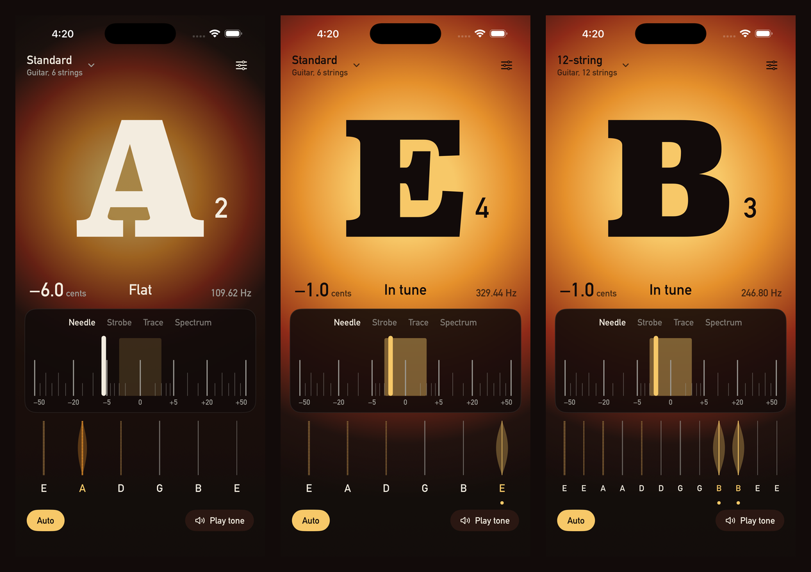

# InstTuner

A free iPhone tuner for guitar and bass, with no paid features. It has no accounts, ads, in-app
purchases or network access.



## What it does

- Tunes guitars with 6, 7 or 8 strings and basses with 4, 5 or 6, and reads down to A0 for low B and drop tunings.
- Has 46 preset tunings, a chromatic mode for any note, and custom tunings where each string can sit a set number of cents off its note.
- Supports equal temperament, 9 historical tuning systems in any key, a custom system, and an A4 reference from 390 to 490 Hz.
- Shows the pitch as a needle, a strobe, a trace over time or a spectrum.
- Plays reference tones. On low notes it turns down the fundamental, which a phone speaker can't play, and keeps the overtones it can.
- Shows the note name large enough to read from a music stand. The glow behind it moves left when you're flat and right when you're sharp.

## Install it on your iPhone

InstTuner isn't on the App Store, and there's no download, because an iPhone only runs apps signed
for it. You build it on a Mac and install it on your own phone. It costs nothing, and the first
install takes about 15 minutes.

If you use a coding agent, point it at [AGENTS.md](AGENTS.md). That file has the exact commands and
lists the steps only you can do on the phone.

You need a Mac with Xcode 26, which is free from the Mac App Store. You also need an iPhone on
iOS 26, a cable, and an Apple Account. A free account works.

1. **Get the code.** Run `git clone https://github.com/jakimoai/inst-tuner.git`, or download the
   ZIP from the green Code button.
2. **Sign in to Xcode.** Open Xcode, open Settings, choose Accounts, and add your Apple Account.
3. **Set up signing.** Open `InstTuner.xcodeproj`, select the InstTuner target, and open the
   Signing & Capabilities tab. Set Team to your account, which shows as "Personal Team" on a free
   account. Change Bundle Identifier to one only you will use, such as `com.yourname.InstTuner`.
4. **Use a release build.** Choose Product, then Scheme, then Edit Scheme. Select Run and set Build
   Configuration to Release. A debug build also works, but its pitch engine runs much slower.
5. **Connect the phone.** Plug it in, unlock it, and tap Trust if it asks.
6. **Turn on Developer Mode.** On the phone, open Settings, then Privacy & Security, then Developer
   Mode. Turn it on and restart when asked. The switch appears only after you've connected the
   phone to Xcode once.
7. **Install.** In Xcode, choose your phone from the device menu at the top, then press Run (⌘R).
8. **Trust yourself as a developer.** The first launch fails with "Untrusted Developer". On the
   phone, open Settings, then General, then VPN & Device Management. Tap your Apple Account, then
   tap Trust.
9. **Open InstTuner** and allow the microphone.

A free account signs the app for 7 days. After that it stops opening, so connect the phone and
press Run again. Your settings and tunings stay. A free account can also keep only 3 apps like this
on a phone at once. The paid Apple Developer Program costs US$99 a year and signs apps for a year.

If something goes wrong, find the message here.

| Message | Fix |
|---|---|
| "Signing for InstTuner requires a development team" | Pick your team in step 3. |
| "Failed to register bundle identifier" | Someone else has that bundle identifier. Make yours more specific in step 3. |
| "Developer Mode disabled" | Turn on Developer Mode in step 6. |
| "Untrusted Developer" on the phone | Trust yourself in step 8. |
| "The maximum number of apps for free development profiles has been reached" | Delete another app you installed this way, or join the paid program. |
| No readings, or the screen says the microphone is off | Open Settings, then InstTuner, and turn on Microphone. |

## How the pitch engine works

1. **Period.** `PeriodDetector` finds how often the waveform repeats. This works even when a phone
   mic can't hear a low string's fundamental.
2. **Octave.** `PitchEngine` decides the octave just after the pluck and keeps it until the next
   one. In a tuning, it uses the open strings to settle doubts. It ignores sound whose level never
   fades, like mains hum.
3. **Pitch.** `PartialAnalyzer` measures each overtone's frequency from how far its phase moves
   between two overlapping snapshots. Then it averages the pitch each overtone implies, weighting
   louder ones more. That average is
   what the ear hears. A stiff bass string's overtones run sharp, so a low E reads a few cents
   above the string's theoretical fundamental, as it does on other tuners. A model of string
   stiffness predicts where to look for each overtone.
4. **Reading.** `PitchTracker` ignores single-frame glitches, follows a real change within 3
   frames, and holds the last reading for 1.6 seconds after the note stops.

The engine lives in `Packages/TunerCore`, which has no UI, so its tests run on a Mac. The SwiftUI
app is in `InstTuner/`.

## Test

```bash
cd Packages/TunerCore && swift test
```

To score real recordings, download the guitar and pizzicato double bass files from the
[University of Iowa samples](https://theremin.music.uiowa.edu/MIS.html) into a folder, then run
this:

```bash
TUNER_RECORDINGS=/path/to/folder swift test --filter RecordingTests
```

Debug builds take launch arguments that replace the mic with a synthesised signal, so you can
work on the screen without an instrument:
`-demo YES -demoString 0 -demoCents m12 -demoTuning b5.standard -demoReadout strobe`.

## Issues and pull requests

I read both, and I welcome both. I work on InstTuner in my spare time, so I can't promise how soon
I'll reply.

- **Found a bug?** Open an issue with your iPhone model, iOS version, instrument and tuning. Say
  what the tuner showed and what you expected. A short screen recording helps a lot.
- **Want a feature?** Open an issue first, so we can agree on it before you write code.
- **Sending a pull request?** Make one change per pull request, and check that `swift test`
  passes. [CONTRIBUTING.md](CONTRIBUTING.md) has the details.

InstTuner will stay free, with no ads, accounts, tracking or network access. I won't merge changes
that add any of those.

## Licence

MIT. See [LICENSE](LICENSE).
